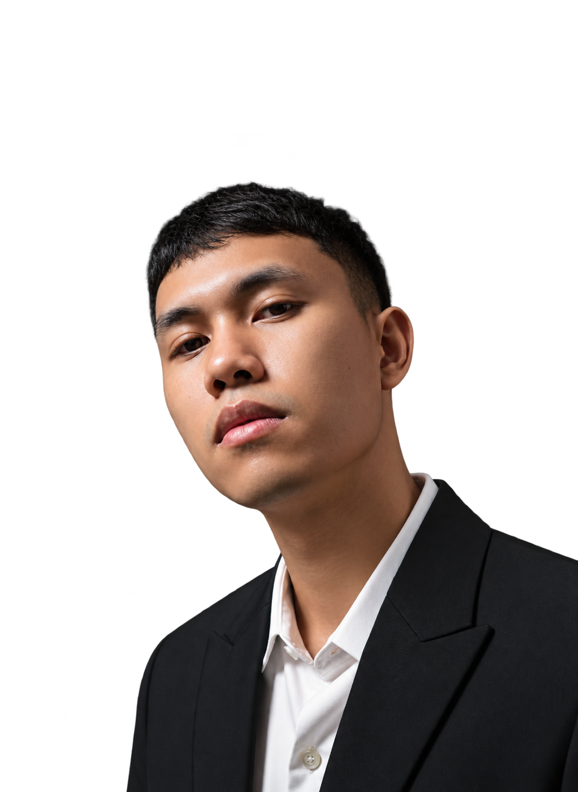

# Yanuar Ramadhian Sutiyono — Portfolio

> **IT Support · Data Analyst · Web Developer**  
> *Connecting systems. Turning data into decisions.*



Interactive, dark-cinematic personal portfolio website featuring responsive design, motion transitions, and verified enterprise and operational projects.

---

## 🛠️ Tech Stack & Ecosystem

- **Frontend & UI**: React 19, Framer Motion 12, Lucide React
- **Build & Bundle**: Node.js, esbuild
- **Styling**: Modular Responsive CSS (Dark Cinematic Theme)
- **Deployment**: Static HTML5 + Single-bundle JS/CSS

---

## 🚀 Key Deliverables & Projects

1. **Centralized Sales Data Center & CRM**
   - Central database for regional multi-channel transactions, reconciliation, and customer relationship management.
   - *Tech*: Laravel 10, MySQL, REST API.

2. **Consignment & Stock Opname Web App**
   - High-concurrency inventory reconciliation system with multi-region database co-location (latency cut from 850ms to 42ms).
   - *Tech*: Supabase, PostgreSQL, Edge Functions, React.

3. **Office Network Infrastructure & Dual-ISP Load Balancing**
   - MikroTik RB4011 setup with PCC load balancing, QoS bandwidth queues, VLAN segmentation, and Netwatch failover.
   - *Tech*: MikroTik RouterOS, Winbox, PCC, Netwatch.

4. **Dashboard CRM & Sales Business Intelligence**
   - Centralized real-time analytical reporting combining multi-channel sales and customer acquisition funnels.
   - *Tech*: Looker Studio, Google BigQuery, SQL, Data Blending.

5. **Sales Forecasting & Performance Analysis**
   - Time-series sales trend analysis and demand projections for inventory planning.
   - *Tech*: Python, Pandas, Matplotlib, Statistical Modeling.

6. **WordPress Custom Themes & Web Management**
   - Custom WooCommerce & corporate theme development and maintenance.
   - *Managed Sites*: [aomsport.com](https://aomsport.com) (Custom Theme), [lindennutrition.id](https://lindennutrition.id) (Custom Theme), [scienceinsport.id](https://scienceinsport.id) (Maintenance).

---

## 💻 Local Development

```bash
# Clone the repository
git clone https://github.com/yanuarRamadhian/portofolio-yanuar-ramadhian.git

# Navigate to project folder
cd portofolio-yanuar-ramadhian

# Install dependencies
npm install

# Start development server with live watch (port 4173)
npm run dev

# Build production bundle
npm run build
```

---

## 📬 Contact & Connect

- **Email**: [ramadhian1999@gmail.com](mailto:ramadhian1999@gmail.com)
- **WhatsApp**: [+62 856-2420-8986](https://wa.me/6285624208986)
- **LinkedIn**: [yanuar-ramadhian-sutiyono](https://id.linkedin.com/in/yanuar-ramadhian-sutiyono-89282218a)
- **GitHub**: [github.com/yanuarRamadhian](https://github.com/yanuarRamadhian)

---

© 2026 Yanuar Ramadhian Sutiyono. Built with purpose.
